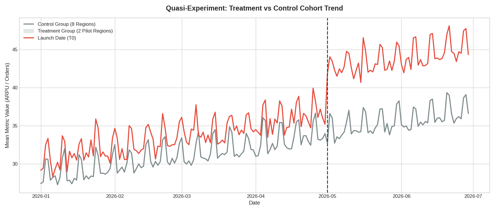
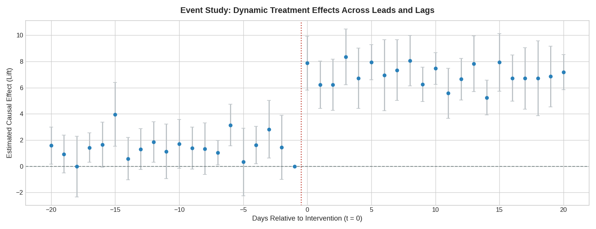
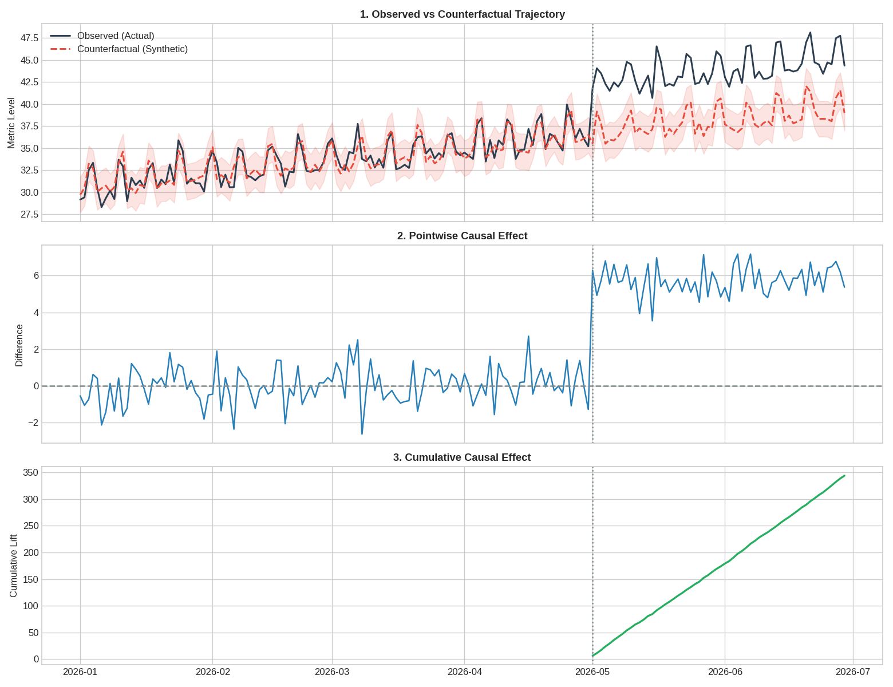

# Causal Product Impact: Yarı-Deneysel Tasarımlar & Karşıolgusal (Counterfactual) Değerlendirme

Ağ etkileri (network effects), platform geneli yaygınlaştırmalar veya bölgesel kısıtlar nedeniyle rastgele A/B testlerinin uygulanamadığı senaryolarda, yeni ürün özelliklerinin gerçek iş etkisini ölçmek için geliştirilmiş uçtan uca nedensel çıkarım (causal inference) çerçevesi.

---

## İş Problemi ve Senaryo

Dijital pazar yerleri ve yüksek işlem hacimli teknoloji platformlarında, kullanıcı seviyesinde rastgele A/B testi açmak bazen gruplar arası etkileşim (SUTVA ihlali) veya operasyonel zorluklar nedeniyle mümkün olmaz.

Bu senaryoda:
- **Müdahale (Intervention):** Dönüşümü ve sepet tutarını artırması hedeflenen "Hızlı Teslimat / Sadakat Rozeti", T_0 anında yalnızca 2 pilot operasyon bölgesinde (`Region_1`, `Region_2`) devreye alındı.
- **Kontrol Grubu:** Yeni özelliğin açılmadığı, sadece genel platform trendine ve mevsimselliğe maruz kalan 8 bağımsız pazar.
- **Amaç:** Pilot bölgelerdeki metrik artışını (ARPU / Sipariş Değeri), organik büyüme trendinden ve haftalık dalgalanmalardan ayrıştırarak özelliğin net **nedensel etkisini (causal lift)** izole etmek.

---

## Metodoloji

### 1. Difference-in-Differences (DiD) & İki Yönlü Kümelenmiş Hatalar
Temel etki aşağıdaki panel regresyon modeli ile tahmin edilmiştir:
Y_{it} = \beta_0 + \beta_1 \cdot \text{Treat}_i + \beta_2 \cdot \text{Post}_t + \delta \cdot (\text{Treat}_i \times \text{Post}_t) + \epsilon_{it}
- Seri korelasyon (otokorelasyon) sapmasını önlemek için standart hatalar bölge düzeyinde kümelenmiştir (CRV1).
- **Paralel Trend Doğrulaması:** Müdahale öncesi dönemde pilot ve kontrol pazarlarının trend eğimleri test edilmiş, gruplar arasında anlamlı bir sapma olmadığı doğrulanmıştır (p > 0.05).

### 2. Event Study & Dinamik Öncül/Ardıl (Lead/Lag) Analizi
Müdahale gününe (T_0) göre normalize edilmiş zaman pencerelerinde ([-20, +20] gün) dinamik katsayılar incelenmiştir:
- Özellik açılmadan önce herhangi bir sızıntı/erken beklenti (anticipation effect) olmadığı kanıtlanmıştır.
- Lansman sonrası etkinin kalıcılığı ve büyüklüğü doğrulanmıştır.

### 3. Sentetik Kontrol & Karşıolgusal (Counterfactual) Modelleme
Etkilenmeyen pazarların ağırlıklı kombinasyonundan pilot bölgeler için sentetik bir ikiz üretilmiştir.
- Noktasal nedensel etki: \tau_t = Y_t^{\text{gözlemlenen}} - \hat{Y}_t^{\text{sentetik}}
- %95 güven aralığı ile kümülatif ek sipariş ve gelir katkısı hesaplanmıştır.

---

## Temel Bulgular & Grafikler

### 1. Kohort Trend Kıyaslaması ve Paralel Trendler
Pilot ve kontrol pazarlarının lansman öncesi dönemde aynı yönde paralel hareket ettiği görülmektedir.



### 2. Dinamik Tedavi Etkisi (Event Study)
t < 0 (lansman öncesi) katsayıları sıfır etrafında dalgalanırken, t \ge 0 anından itibaren katsayılar doğrudan pozitif banda sıçramaktadır.



### 3. Sentetik Karşıolgusal Ayrışma & Kümülatif Etki
Gerçekleşen performans ile "özellik hiç açılmasaydı ne olurdu?" tahmini arasındaki fark lansman sonrası belirginleşmektedir.



- **Günlük Ortalama Nedensel Etki (\delta):** ~5.72 birim / gün (p < 0.001)
- **Kümülatif Ek Katkı:** 60 günlük lansman sonrası pencerede ~345+ ek metrik birimi.
- **Göreceli Büyüme (Lift):** Sentetik baz çizgiye göre net %14.8 nedensel büyüme.

---

## Repo Yapısı

- `notebooks/`: Veri simülasyonu, ekonometrik testler, event study ve sentetik kontrol modellerini içeren çalıştırılabilir notebook.
- `data/`: 10 bölge ve 180 günü kapsayan simüle edilmiş panel veri seti.
- `visuals/`: Raporlama için üretilmiş yüksek çözünürlüklü grafikler.

---

<br>

# English Version

# Causal Product Impact: Quasi-Experimentation & Counterfactual Evaluation

An end-to-end causal inference and quasi-experimental framework designed to measure feature release impact when randomized A/B testing is infeasible due to network effects, platform-wide rollouts, or regional constraints.

---

## Business Problem & Context

Digital marketplaces and high-frequency tech platforms frequently release features where standard user-level A/B splits cannot be deployed without cross-group spillover (SUTVA violation) or marketing dilution. 

In this scenario:
- **Intervention:** A conversion-enhancing delivery badge rolled out exclusively across two pilot operational markets (`Region_1`, `Region_2`) at T_0.
- **Control Cohort:** 8 unexposed markets exposed solely to macroscopic demand shifts and secular platform growth.
- **Goal:** Isolate the true incremental treatment effect (Causal Lift) on average user order value/ARPU from underlying organic trends and seasonal variance.

---

## Methodological Architecture

### 1. Difference-in-Differences (DiD) & Two-Way Clustered Errors
The baseline impact is estimated via linear panel formulation:
Y_{it} = \beta_0 + \beta_1 \cdot \text{Treat}_i + \beta_2 \cdot \text{Post}_t + \delta \cdot (\text{Treat}_i \times \text{Post}_t) + \epsilon_{it}
- Standard errors are clustered at the market level (CRV1) to eliminate serial correlation bias.
- **Parallel Trends Validation:** Evaluated by testing the differential pre-intervention growth rate between cohorts (\beta_{\text{trend}} \times \text{Treat}_i, p > 0.05).

### 2. Event Study & Dynamic Lead/Lag Specification
Dynamic treatment coefficients across lead and lag periods ([-20, +20] relative to T_0) ensure:
- Absence of pre-treatment anticipation effects (anticipation bias).
- Persistence and stability of the post-launch lift.

### 3. Synthetic Counterfactual Modeling (Bayesian Structural Analogy)
Constructs a synthetic control market using an optimal weighted vector of unexposed units.
- Generates point-wise incremental impact: \tau_t = Y_t^{\text{obs}} - \hat{Y}_t^{\text{synthetic}}
- Calculates cumulative business lift with predictive confidence intervals (95\% CI).

---

## Key Findings & Visual Evidence

### 1. Cohort Trajectory & Parallel Trends
Pre-treatment co-movement between pilot and control regions confirms structural trend consistency prior to intervention.


### 2. Dynamic Treatment Effect (Event Study)
Estimated dynamic coefficients hover around zero across all leads (t < 0) and jump immediately to the expected causal range at t \ge 0, rejecting pre-trend contamination.


### 3. Counterfactual Decomposition & Cumulative Lift
Comparing actual market performance against the unobserved counterfactual reveals steady, sustained divergence post-launch.


- **Empirical Treatment Effect (\delta):** ~5.72 units / day (p < 0.001)
- **Cumulative Incremental Lift:** ~345+ additional metric units over the 60-day post-window.
- **Relative Growth:** ~14.8% net causal expansion over counterfactual baseline.

---

## Repository Structure

- `notebooks/`: Executable notebook detailing data generation, econometric checks, event studies, and counterfactual models.
- `data/`: Panel dataset across 10 regions over 180 observation days.
- `visuals/`: High-resolution figures generated for executive reporting.

---

## Quickstart

```bash
git clone [https://github.com/mirhankardess/causal-product-impact.git](https://github.com/mirhankardess/causal-product-impact.git)
cd causal-product-impact
pip install -r requirements.txt
jupyter notebook notebooks/quasi_experiment_analysis.ipynb
